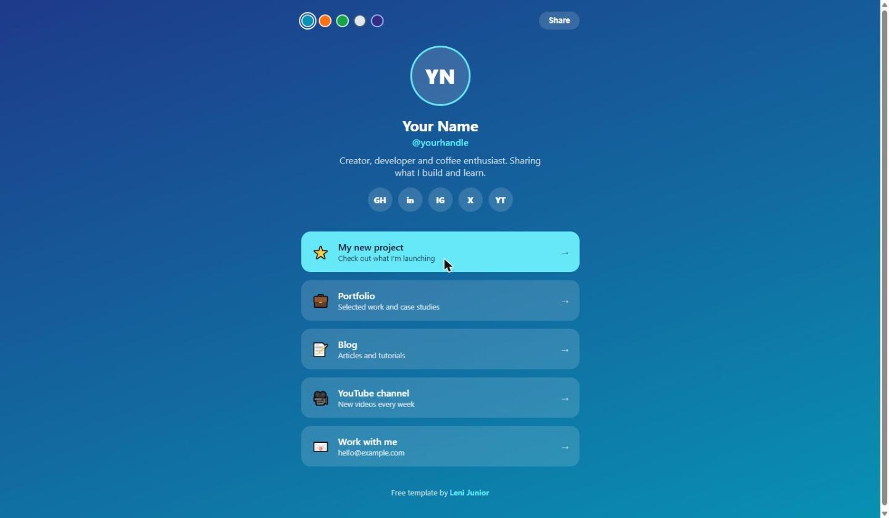

# Link-in-Bio Page

A free, self-hosted alternative to Linktree, built with plain HTML5, CSS3 and JavaScript, no framework. One clean page with your photo, bio, social icons and link buttons, with 5 themes and a share button. Ready to download and publish in minutes.



**[Live Demo](https://lenivalestevao.github.io/link-in-bio-page/)**

## Features

- Profile with photo (or initials), name, handle and bio
- Featured link highlight plus unlimited link buttons
- Social icon row
- 5 built-in themes (ocean, sunset, forest, light, midnight) with a theme picker
- Share button (native share sheet, or copy link)
- Smooth entrance animation, respects reduced-motion settings
- Mobile-first and accessible
- Zero dependencies: pure HTML, CSS and vanilla JavaScript

## Getting Started

1. Download or clone this repository
2. Open `script.js` and edit the `profile`, `links` and `socials` blocks at the top
3. Open `index.html` in your browser. No build step required

## Customization

```js
const profile = {
  name: "Your Name",
  handle: "@yourhandle",
  bio: "Creator, developer and coffee enthusiast.",
  avatar: "me.jpg",
  defaultTheme: "ocean"
};

const links = [
  { icon: "⭐", title: "My new project", note: "Check it out", url: "https://example.com", featured: true }
];
```

Want your own colors? Add a new `[data-theme="..."]` block at the top of `style.css` and add its name to the `themes` array.

## Deploy for free

Enable **GitHub Pages** (Settings, Pages, Deploy from branch `main`) and use the link in your Instagram, TikTok or X bio.

## Project Structure

```
link-in-bio-page/
├── index.html   # Page structure
├── style.css    # Themes and layout
├── script.js    # Your content + rendering
└── README.md
```

## License

MIT. Free to use for personal or commercial projects. A link back is appreciated but not required.

Made by [Leni Junior](https://github.com/lenivalestevao). Check out my other free templates on my profile.
